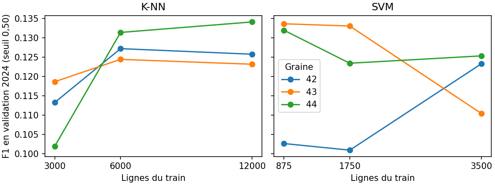

# Wildfire Atlas — classification des détections d’incendie

Wildfire Atlas compare six classifieurs supervisés sur des cellules-jours et permet d’explorer leurs résultats dans Streamlit. Le SVM sélectionné retrouve 900 des 1 122 détections du test 2025. Il produit également 4 814 faux positifs. Les mesures de la journée et le choix des négatifs limitent l’interprétation à la classification rétrospective dans cet échantillon.

[Rapport collectif PDF](docs/Rapport_MiniProject.pdf) · [Source éditable](docs/Rapport_MiniProject.md) · [Guide de l’interface](docs/INTERFACE.md) · [Conformité au cahier des charges](docs/MATRICE_CONFORMITE.csv)

## Lancement local

Depuis un terminal, télécharger le projet collectif :

```bash
git clone https://github.com/hani231/Algeria-Wildfire-Risk-121k-Labelled-Cell-Days.git
cd Algeria-Wildfire-Risk-121k-Labelled-Cell-Days
```

Depuis le clone contenant la branche du benchmark final, utiliser Python 3.12. Sous PowerShell :

```powershell
py -3.12 -m venv .venv
.\.venv\Scripts\python.exe -m pip install -r requirements-dev.txt
.\.venv\Scripts\python.exe -m pytest -q
.\.venv\Scripts\python.exe -m streamlit run src/app.py
```

Sous Linux/macOS :

```bash
python3.12 -m venv .venv
source .venv/bin/activate
python -m pip install -r requirements-dev.txt
python -m pytest -q
python -m streamlit run src/app.py
```

Ouvrir l’adresse locale indiquée par Streamlit. Les huit pipelines du studio sont fournis. L’application charge les artefacts existants, contrôle le schéma et les unités puis classe les mesures soumises. Le catalogue, les prédictions, les matrices et les courbes utilisent un registre commun. Le fond cartographique est local.

## Données et protocole

Le seul brut attendu est `Dataset/dataset.csv`. Il compte **121 869 lignes, 37 colonnes et 1 423 cellules**. Les exports `Dataset/processed.csv` et `data/processed/dataset_clean.csv` appartiennent aux étapes historiques. Le benchmark repart du brut. Les six fonctions EDA sont disponibles sur le train, avec filtrage conjoint et export. La population rectangulaire inclut des cellules hors d’Algérie. Données d’Abdelmalek Nedjar, météo Open-Meteo/ERA5-Land, NASA FIRMS et MODIS, sous CC BY 4.0. [Sources, attributions et contrôles](docs/SOURCES.md) · [Dictionnaire](docs/dictionnaire_colonnes.md)

| Partition | Années | Effectif | Usage |
|---|---|---:|---|
| Entraînement | 2012–2023 | 104 979 | Cinq validations annuelles internes 2019–2023, apprentissage sur les années antérieures |
| Validation | 2024 | 8 423 | Comparaison des modèles et choix du seuil |
| Test | 2025 | 8 467 | Une règle finale gelée avant évaluation |

La configuration active est `config/protocole.json`. Les dates, coordonnées, identifiants, label, split, sample_kind, n_detections et max_frp restent hors des prédicteurs. Les historiques days_since_last_fire, ndvi_normal et ndvi_anomaly sont aussi exclus. Les transformations sont apprises dans chaque pli. La graine vaut 42. Les trois seuils de candidature sont 0,20, 0,35 et 0,50. Le modèle et le seuil maximisant le F1 de validation parmi les six obligatoires sont gelés sans réajustement. La validation chronologique diffère du K-Fold classique demandé. Son acceptation par le professeur reste à confirmer.

## Résultats

| Modèle obligatoire | F1 CV moyen | F1 2024 à 0,50 | ROC-AUC 2024 | AP 2024 |
|---|---:|---:|---:|---:|
| Zero-R | 0,000 | 0,000 | 0,500 | 0,076 |
| GaussianNB | 0,410 | 0,174 | 0,631 | 0,122 |
| Arbre | 0,425 | 0,160 | 0,608 | 0,100 |
| Random Forest | 0,430 | 0,167 | 0,615 | 0,104 |
| K-NN | 0,386 | 0,126 | 0,601 | 0,098 |
| SVM | 0,412 | 0,123 | 0,630 | 0,120 |

K-NN utilise 12 000 lignes d’apprentissage par ajustement et SVM 3 500. Les validations utilisent toutes les lignes de chaque année. Le nouvel arbre est compatible avec scikit-learn 1.8.0. Le lot final reproduit le GaussianNB à 14 réglages (F1 0,173585). L’ancien notebook à 7 réglages obtenait 0,176681. Les deux modèles supplémentaires LogisticRegression et HistGradientBoosting restent consultables avec leurs résultats d’origine. [Comparatif complet et temps](results/benchmark_final/metrics.csv) · [Paramètres et empreintes](results/benchmark_final/manifest.json)

Le SVM linéaire au seuil de **0,20** obtient un F1 2024 de **0,176646**. Le commit de gel est `ece0598`. Sur 2025 il obtient **0,158 de précision**, **0,802 de rappel**, **0,263 de F1**, **0,610 de ROC-AUC** et **0,178 d’Average Precision**. L’AP utilise la somme des précisions pondérée par les increments de rappel. Aucune variante n’a été choisie à partir du score final. Les négatifs échantillonnés, la météo contemporaine et la réutilisation de 2024 durant le développement limitent la généralisation. [Décision](results/benchmark_final/decision.json) · [Évaluation finale](results/test_final/result.json)

À cellule et année comparables, l’écart moyen des jours positifs est de +3,077 °C et −10,107 points d’humidité. Les tests des signes sur les années donnent p ajustée par Holm de 0,00097656. Les associations persistent avec appariement mensuel. [Analyses et limites](docs/Rapport_MiniProject.pdf)

## Reproduction

Après activation du venv, depuis la racine, employer des dossiers de sortie neufs pour les expériences. Les audits reproduisent les tableaux sous results/audit_siad03.

```bash
python -m src.audit_data
python -m src.statistical_analysis
python -m src.models --output results/local_runs/benchmark
python -m src.feature_comparison --output results/local_runs/benchmark/ablation_train.csv
python -m src.final_evaluation --output results/local_runs/test_gele
python -m src.build_report
```

L’avant-dernière commande reproduit uniquement l’évaluation du **modèle publié et gelé**. Elle vérifie la décision inscrite dans Git et les empreintes des données, de la configuration et de l’artefact. La génération du PDF utilise Pandoc et XeLaTeX installés sur le système. Le gabarit Markdown accepte des tableaux injectés depuis les CSV et la figure ROC/PR est régénérée à partir des scores. Les versions du lot et les temps sont inclus dans le manifeste et les CSV. L’installation locale de l’app se limite aux dépendances Python.

## Expériences complémentaires et vérification

Après le gel, l’expérience de taille conserve les réglages du benchmark et mesure trois tirages par taille sur 2024. Le CSV comporte le F1 au seuil 0,50 et les temps de calcul. Le résultat de chaque tirage est accessible dans [le tableau complet](results/post_freeze/size_2024/learning_curves.csv).

```bash
python -m src.learning_curves --output results/local_runs/size_2024
```

Le PDF livré a été produit avec Pandoc et WeasyPrint. Pour utiliser ce moteur, installer `weasyprint==70.0` avec ses dépendances système et définir la variable d’environnement `PANDOC_PDF_ENGINE` à `weasyprint` avant de lancer `python -m src.build_report`. Le moteur par défaut reste XeLaTeX.

Le brut versionné sous `Dataset/` est la source commune. Il remplit le rôle du répertoire `data/raw/` dans le plan du professeur. Garder une seule copie évite deux versions concurrentes. Le notebook 01 exécute le nettoyage et écrit les exports historiques. Pour l’exécuter sans écraser ses propres exports, utiliser un clone de travail. Le notebook 02 vérifie les entrées numériques et les plis. Le notebook 03_model_training_evaluation relit les paramètres et les scores du benchmark. Le notebook 03_zeror_naive_bayes reproduit l’expérience historique distincte.

## Organisation et contributions

| Emplacement ou contribution | Contenu |
|---|---|
| src/preprocessing.py, src/models.py | Contrat commun, plis et recherches |
| src/app.py, src/ui/, src/eda_view.py | Six espaces Streamlit et services |
| notebooks/, src/siad03_nb/, src/siad03_extensions/ | Lots de développement historiques et analyses complémentaires |
| results/benchmark_final/, results/test_final/ | Lots actifs des six modèles et décision gelée |
| models/, results/protocole_propose.json | Pipelines et paramètres historiques conservés pour traçabilité |
| SIAD03 | Audit, EDA, statistiques, Zero-R/NB, interface, puis intégration du benchmark des six modèles, tests et rapport avec assistance de développement |
| Responsable du prétraitement (code à confirmer) | Cadrage du dépôt et travaux initiaux de préparation selon l’historique et le plan |
| Responsable de l’intégration (code à confirmer) | Arbre historique et résultats associés. L’arbre du benchmark commun a été réentraîné dans le lot SIAD03 |

Le plan de démarrage est conservé dans une version publique anonymisée. Les contributions se vérifient par commit. Les documents des premiers lots décrivent leur état à la date de rédaction. [Plan initial](docs/Plan_initial_equipe.pdf)

Les variantes complémentaires isolent certains effets du nombre de voisins, de la pondération, de la profondeur, de l’élagage, du nombre d’arbres ou du noyau. Elles utilisent les cinq plis du train et laissent le modèle publié inchangé. GaussianNB dispose déjà de 14 valeurs de lissage dans le benchmark. Reproduction dans un dossier neuf :

```bash
python -m src.parameter_sensitivity --output results/local_runs/parameters
```



À 6 000 puis 12 000 lignes, le F1 moyen de K-NN reste voisin de 0,128. Pour SVM, les trois moyennes se situent entre 0,119 et 0,123. Sur cette saison et au seuil de 0,50, augmenter la taille dans la plage étudiée ne garantit donc pas un gain.

Sur les cinq saisons internes, retirer la pondération des classes de la forêt fait passer son F1 moyen de 0,4305 à 0,3927. Passer de 32 à 48 arbres le porte à 0,4317. Ces comparaisons dépendent des autres réglages maintenus constants. [Scores par pli et paramètres modifiés](results/post_freeze/parameters)
