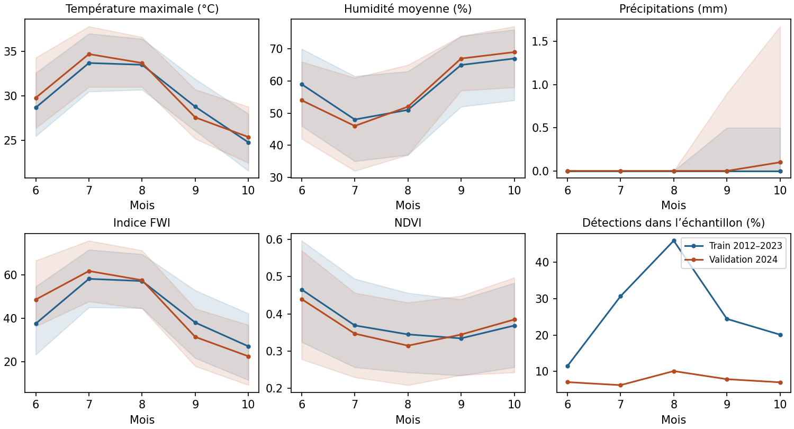

# Transfert entre saisons et erreurs du SVM

La question est de savoir dans quelles conditions le modèle retrouve les détections étiquetées et combien d’alertes il produit alors. Le diagnostic relie les scores enregistrés de validation à la cellule et au jour correspondants. Il vérifie l’unicité des clés, l’égalité des dates, des années et des cibles, ainsi que l’intervalle des scores. Le modèle et son seuil de 0,20 proviennent de la décision gelée. La source des observations est le CSV brut vérifié contre l’empreinte du protocole, après exclusion des lignes de test. L’analyse réutilise les scores et ne requiert aucun ajustement.

## Changements de population

Le train 2012–2023 compte 28 586 positifs sur 104 979 observations (27,2 %). En 2024, 643 observations sur 8 423 sont positives (7,6 %). Comparer les mois à l’intérieur de la saison réduit la confusion entre climat et calendrier. Un même mois du train regroupe les cellules-jours disponibles des douze années. Les mois, années et cellules n’ont donc pas nécessairement le même poids. La médiane décrit l’observation centrale et la bande couvre les deux quartiles centraux. L’effectif mesuré figure à côté de l’effectif total dans le fichier source. Les proportions positives incluent toutes les observations du mois.



En juillet, la température maximale médiane passe de 33,7 à 34,7 °C, alors que la part positive passe de 6 427/20 951 à 106/1 706. Une différence de température moyenne ne suffit donc pas à expliquer le changement de fréquence. En août, le NDVI médian descend de 0,345 à 0,314. Une médiane de pluie nulle indique qu’au moins la moitié des observations du groupe sont sèches. Les erreurs stratifiées du CSV distinguent aussi les lignes pluvieuses. [Quantiles par mois](../results/post_freeze/development_profiles/distributions_mensuelles.csv) · [Décalages globaux sur toutes les variables](../results/siad03_extensions/exploration/drift_2024.csv)

Les données couvrent 41 blocs de 1° sur le train et 40 en validation. Le nom d’un bloc donne ses bornes sud et ouest en degrés. Ces blocs suivent la grille d’observation, qui déborde des frontières de l’Algérie. Chaque ligne de la table géographique donne le dénominateur et le nombre de détections. La fréquence mélange la distribution spatiale des observations et la sélection des jours. Sa variation ne mesure pas directement un changement de risque territorial. [Répartition géographique](../results/post_freeze/development_profiles/geographie.csv)

## Quelles erreurs en 2024 ?

Chaque découpage partitionne les mêmes 8 423 lignes. Les quartiles de température, humidité, précipitations, FWI et NDVI sont calculés exclusivement sur le train. Les bornes identiques sont regroupées. Une valeur manquante constitue une strate explicite. Le rappel vaut VP/(VP+FN) et la précision VP/(VP+FP). Une case vide signale un dénominateur nul. Il serait incorrect d’additionner les effectifs de découpages différents.

| Température maximale | Effectif | Détections retrouvées / positives | Fausses alertes | Précision |
|---|---:|---:|---:|---:|
| ≤ 26,3 °C | 2 086 | 10 / 73 | 128 | 7,2 % |
| > 26,3 à 30,2 °C | 2 097 | 73 / 154 | 665 | 9,9 % |
| > 30,2 à 34,2 °C | 1 941 | 148 / 168 | 1 452 | 9,3 % |
| > 34,2 °C | 2 299 | 244 / 248 | 2 015 | 10,8 % |

Le SVM émet des alertes sur 2 259 des 2 299 journées du groupe le plus chaud. Il y retrouve presque toutes les détections, mais seulement 244 de ces alertes correspondent à une étiquette positive. La température est contemporaine de la détection et corrélée aux autres variables. Ces taux conditionnels ne mesurent pas son effet causal. Dans le bloc 36:3, le plus gros nombre de fausses alertes (543) s’accompagne d’un fort volume observé (1 102 lignes). Le rappel local est de 52/83. Les petites strates doivent être lues avec leurs effectifs. [Comptes par condition et par bloc](../results/post_freeze/development_profiles/erreurs_2024.csv)

Sur l’ensemble de la validation, il y a 475 vrais positifs, 168 faux négatifs, 4 260 faux positifs et 3 520 vrais négatifs. Monter le seuil à 0,35 économise 2 216 fausses alertes et manque 216 positifs supplémentaires. La précision dépend de la fréquence de la classe positive et du plan de sélection des négatifs. Le calcul mensuel au seuil retenu est déjà publié. [Mois](../results/post_freeze/alerts_2024/months.csv) · [Seuils](../results/post_freeze/alerts_2024/thresholds.csv)

## Où se situe l’incertitude entre années ?

Au seuil de 0,50 et aux paramètres de la grille retenue, les F1 temporels du SVM sont de 0,467 en 2019, 0,543 en 2020, 0,427 en 2021, 0,304 en 2022 et 0,316 en 2023. Chaque point concerne un ajustement sur les années antérieures. Les résultats publiés comprennent le F1 par pli mais pas les prédictions individuelles hors pli de ces cinq années. Le détail annuel des faux positifs et négatifs au seuil 0,20 ne peut donc pas en être déduit. Prédire rétrospectivement sur les données d’apprentissage du modèle gelé biaiserait cette comparaison. [Recherche SVM](../results/benchmark_final/SVM_cv.csv)

| Famille | F1 apprentissage KFold | F1 validation KFold | F1 validation chronologique |
|---|---:|---:|---:|
| Zero-R | 0,000 | 0,000 | 0,000 |
| GaussianNB | 0,507 | 0,507 | 0,410 |
| Arbre | 0,552 | 0,541 | 0,425 |
| Forêt | 0,600 | 0,563 | 0,430 |
| K-NN | 0,516 | 0,443 | 0,386 |
| SVM | 0,317 | 0,301 | 0,412 |

Les moyennes portent sur cinq plis et les réglages communs aux deux évaluations. Le KFold mélangé partage des années entre apprentissage et validation. Les années de validation chronologique représentent une saison ultérieure entière. L’écart d’apprentissage/validation du K-NN en KFold est supérieur à celui de GaussianNB. La stabilité d’un score faible ne démontre pas que le modèle est assez expressif. Les plafonds K-NN (12 000) et SVM (3 500) limitent le coût et l’exposition aux données. Une étude existante quantifie déjà la sensibilité à la taille et aux tirages, avec 2024 comme validation. Le test final 2025 mesure uniquement la règle gelée. L’acceptation pédagogique du protocole principal reste à confirmer. [Plis du train](../results/post_freeze/kfold_train/folds.csv) · [Tailles d’apprentissage](../results/post_freeze/size_2024/learning_curves.csv) · [Temps, matrices et métriques](../results/benchmark_final/metrics.csv)

Deux expériences supplémentaires apportent des points de comparaison à seuil 0,50. La régression logistique ajuste une imputation médiane et une échelle dans chaque pli, tandis que le boosting par histogrammes traite les manquants nativement. La recherche de six réglages logistiques et de huit réglages de boosting a donné respectivement 0,426 et 0,436 de F1 temporel moyen. Le F1 2024 descend à 0,185 et 0,167. Les durées publiées de la recherche sont 16,7 s et 41,2 s sur la machine d’origine. Le lot enregistre aussi les temps de prédiction. Il ne distingue pas une durée d’ajustement final isolée et ne publie pas de scores d’apprentissage par pli pour ces deux modèles. La baisse en 2024 mélange variation de cohorte et de fréquence des classes, ce qui limite tout diagnostic de surapprentissage. [Recherche supplémentaire](../results/siad03_extensions/benchmark/search_summary.json) · [Métriques supplémentaires](../results/siad03_extensions/benchmark/metrics.csv)

## Statistiques et contrat K-NN/ACP

Les tests des signes comparent l’écart annuel moyen positif−négatif, après appariement par cellule et année. H0 donne une probabilité de 0,5 à un signe positif parmi les écarts non nuls. H1 est bilatérale. Cette approche évite de traiter les cellules-jours comme des répétitions indépendantes et se passe d’une approximation normale sur douze signes. Les estimations d’effet s’expriment en unités d’origine. La température maximale donne +3,077 °C et l’humidité moyenne −10,107 points. Les douze signes vont dans le même sens pour chaque variable. Chaque p brute vaut 0,0004883. Après correction de Holm des deux tests, p vaut 0,0009766. L’appariement supplémentaire par mois donne +2,307 °C et −9,591 points sur les mêmes années. La dépendance temporelle entre les signes pourrait affecter les p-values. Les sept sorties statistiques ont été régénérées dans un dossier temporaire et comparées octet par octet. [Sorties principales](../results/audit_siad03/statistiques_principal.csv) · [Sensibilité mensuelle](../results/audit_siad03/statistiques_sensibilite_mois.csv)

Le code source producteur construit la normale NDVI sur 2000–2011. La traçabilité partielle des composites et du CSV local empêche de certifier sa disponibilité ligne par ligne. Sa présence est donc un écart de contrat, sans preuve directe de fuite. Les notebooks secondaires utilisent 25 entrées, des objets sérialisés séparément sous scikit-learn 1.9.0 et plusieurs comparaisons sur la validation 2024. Le benchmark officiel utilise 24 entrées et scikit-learn 1.8.0. Les performances AP des variantes ACP et le F1 au seuil gelé répondent à des questions différentes. Toute intégration ultérieure exige une évaluation à budget, version, entrées et métrique comparables, avec sélection sur les seuls plis du train. [Sources NDVI](SOURCES.md) · [Expérience ACP](AUDIT_REEVALUATION.md)

## Reproduction

Depuis la racine, après installation de requirements-dev.txt, utiliser un répertoire de sortie neuf.

```bash
python -m src.development_profiles --output results/local_runs/profils_developpement
python -m src.statistical_analysis --output results/local_runs/tests_apparies
python -m pytest -q tests/test_development_profiles.py tests/test_statistics.py tests/test_kfold_diagnostic.py tests/test_final_benchmark.py
```
