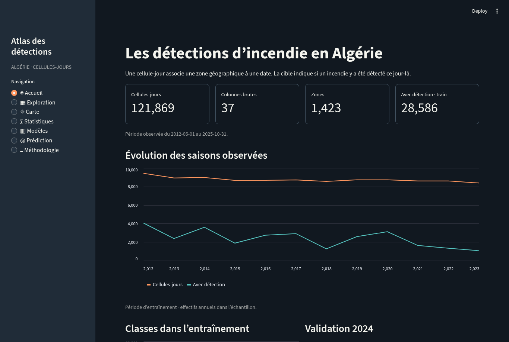

# SIAD03 — Analyse des détections d’incendie et interface Wildfire Atlas

## Données et contrôle qualité

Une ligne associe une cellule géographique à une journée. Les 121 869 lignes du brut couvrent 1 423 cellules et 37 colonnes. Les négatifs ayant été échantillonnés, la proportion de lignes positives décrit le fichier. Elle ne mesure pas la fréquence territoriale des incendies. Le nettoyage vérifie les clés cellule/date, les dates, les bornes physiques et les doublons exacts. L’audit versionné compte zéro doublon exact supprimé et zéro violation des contrôles physiques répertoriés. Les valeurs manquantes des prédicteurs restent disponibles pour une imputation apprise dans chaque pli. [Audit du CSV](../../results/audit_siad03/qualite.json)

Les variables sample_kind, n_detections et max_frp renseignent directement la cible ou sa construction. Le modèle les exclut, ainsi que split et label. Les historiques days_since_last_fire, ndvi_normal et ndvi_anomaly restent exclus en attendant de connaître leur disponibilité à la date considérée. Les 24 prédicteurs autorisés servent à classer une observation de la journée. Le train couvre 2012–2023, la validation 2024 et le test réservé 2025. [Protocole](../../results/protocole_propose.json)

## Exploration et questions statistiques

Le train comprend 28 586 cellules-jours positives et 76 393 négatives. Les statistiques descriptives et les quartiles utilisent toutes les valeurs présentes dans la sélection. L’histogramme et la densité utilisent un échantillon déterministe de 5 000 valeurs au maximum. L’effectif commun d’une paire aide à interpréter sa corrélation de Spearman lorsque les valeurs manquantes diffèrent entre variables. La carte regroupe les observations aux coordonnées de leur cellule. Une grande cellule figurée sur la carte signale un effectif élevé dans l’échantillon.

À zone et année comparables, les jours positifs présentent-ils une température maximale plus élevée ou une humidité moyenne plus basse ? Les écarts entre classes sont agrégés par année pour limiter la pseudo-réplication. Pour chaque variable, H0 attribue la même probabilité aux deux signes d’un écart annuel non nul. H1 autorise des probabilités différentes. Le test binomial exact bilatéral utilise les signes des années et évite une hypothèse de normalité des amplitudes.

| Appariement | Écart moyen de température maximale | Écart moyen d’humidité | Signes sur 12 années |
|---|---:|---:|---|
| Zone et année | +3,0769 unités source | −10,1067 points | 12 positifs pour la température, 12 négatifs pour l’humidité |
| Zone, année et mois | +2,3071 unités source | −9,5909 points | Mêmes signes |

Pour chaque variable, p brute vaut 0,00048828125 et p ajustée 0,0009765625. Holm prend en compte les deux tests de chaque famille. L’appariement mensuel réduit les écarts et conserve leur direction. Cette sensibilité réutilise les observations de l’analyse principale. La dépendance possible entre années et la sélection des négatifs limitent la portée des associations. [Analyse principale](../../results/audit_siad03/statistiques_principal.csv) · [Sensibilité](../../results/audit_siad03/statistiques_sensibilite_mois.csv)

## Zero-R et GaussianNB

Zero-R apprend la classe majoritaire. GaussianNB estime pour chaque classe des distributions gaussiennes par variable, avec une hypothèse d’indépendance conditionnelle fragile pour des mesures météorologiques corrélées. L’imputation médiane et la standardisation sont ajustées sur le train de chaque pli. Dans run_01, la recherche sur 14 valeurs de var_smoothing retient 1,0 par le F1 moyen des cinq plis temporels (0,410006). Le seuil de classification est 0,5. [Provenance et grille](../../results/siad03_nb/run_01/provenance.json)

| Validation 2024 | Vrais positifs | Faux positifs | Faux négatifs | Précision | Rappel | F1 | ROC-AUC | AP |
|---|---:|---:|---:|---:|---:|---:|---:|---:|
| Zero-R | 0 | 0 | 643 | 0 | 0 | 0 | 0,5000 | 0,0763 |
| GaussianNB, run_01 | 437 | 3 955 | 206 | 0,0995 | 0,6796 | 0,173585 | 0,6314 | 0,1224 |

Sur les 8 423 observations de validation, Zero-R obtient une accuracy de 92,37 % tout en manquant toutes les détections. GaussianNB en retrouve 437 au prix de nombreuses fausses alertes. L’ancien réglage 0,01 (sept candidats) obtenait un F1 de 0,176681. Le classement et les prédictions de l’application utilisent le lot reproductible run_01. Le seuil et le réglage n’ont pas été révisés pour améliorer le score affiché. Les probabilités restent sensibles à la calibration et à l’échantillonnage. [Métriques](../../results/siad03_nb/run_01/metrics.csv) · [Courbes et diagnostic](../siad03_nb/RESULTATS.md)

## Interface et reproduction

L’entrée Streamlit src/app.py relie la vue d’ensemble, l’EDA, la carte hors ligne, le classement des modèles, le studio de classification et la méthodologie. Les services chargent les données et les modèles en cache. Les contrôles de schéma, de version et de cohérence physique interviennent avant une prédiction. Le studio présente uniquement les pipelines compatibles disponibles. Les six modèles obligatoires peuvent être suivis dans Model Arena, y compris les entrées encore en attente. [Guide et commandes d’installation](../INTERFACE.md)

Depuis un environnement Python 3.12 installé avec requirements-dev.txt, lancer `python -m pytest -q` puis `python -m streamlit run src/app.py`. Les tests vérifient notamment navigation, remise à zéro, données manquantes, parité entre prédiction et pipeline, matrices de confusion et intégrales des courbes sur 2024. La commande `python -m src.siad03_nb.experiment --output results/local_runs/reproduction_01` reproduit le lot personnel dans un dossier neuf. Le manifeste enregistre versions et empreintes pour comparer deux exécutions. [Procédure scientifique](../siad03_nb/README.md)

L’intégration finale dépend des artefacts des autres responsables, du gel du protocole et de la validation collective des unités. L’évaluation sur 2025 est réservée à l’équipe après ce gel.
