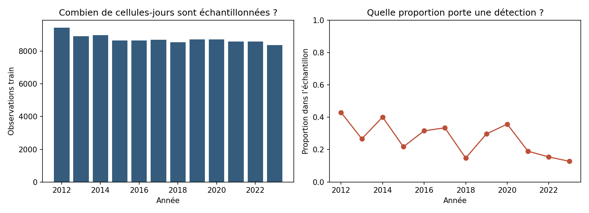
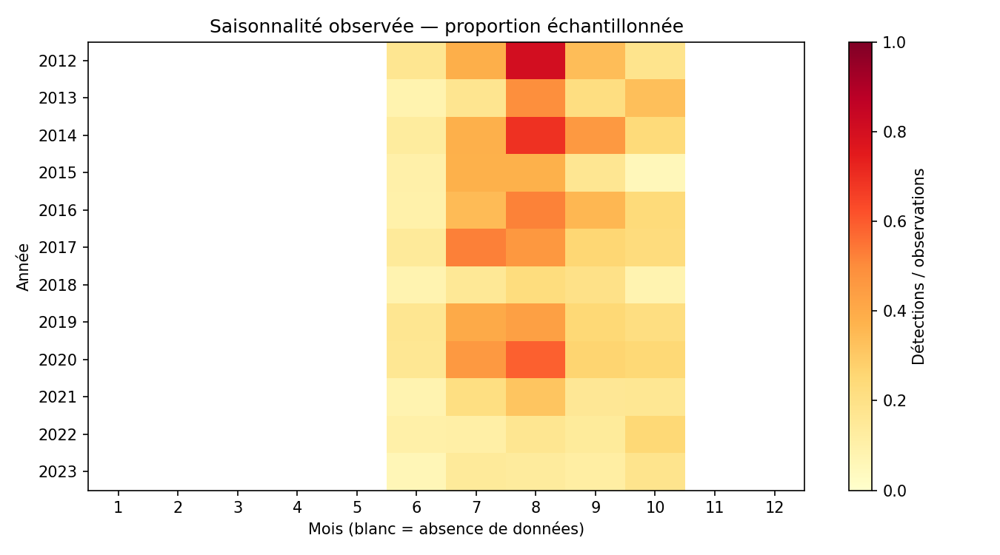
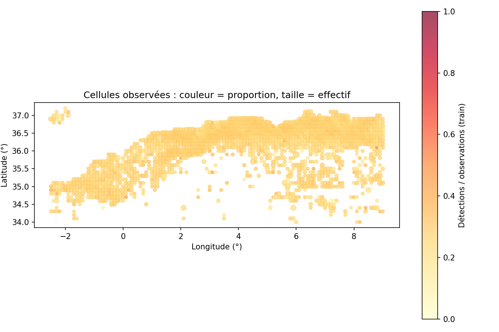
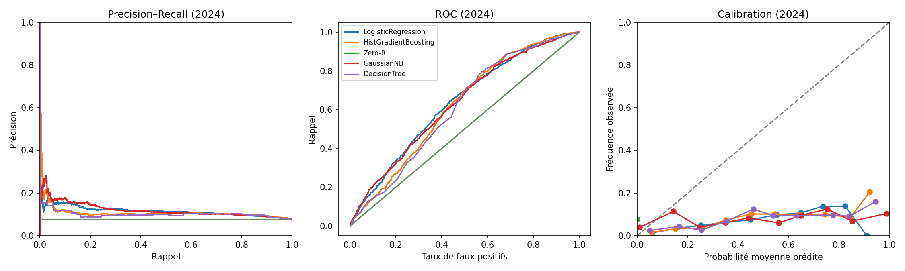
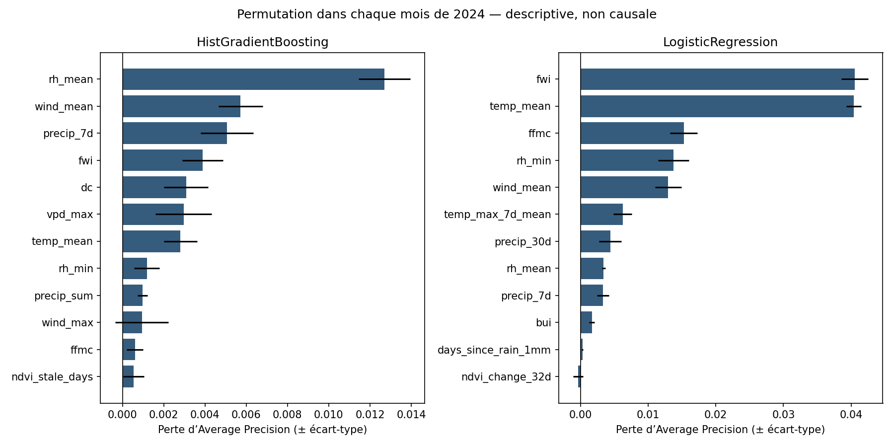

# Détections d'incendies en Algérie : extensions scientifiques

Contribution SIAD03 — 15 novembre 2026. Annexe personnelle destinée au rapport collectif.

## 1. Problématique et état initial

L'objectif est de classifier des cellules-jours portant ou non une détection, avec des variables météorologiques, environnementales et calendaires. Il ne s'agit pas d'estimer directement une probabilité territoriale d'incendie ni de démontrer une capacité d'alerte anticipée.

La base locale 0b49805 contenait deux notebooks, trois modèles (Zero-R, GaussianNB, DecisionTree), un nettoyage déterministe, des statistiques appariées, un dashboard EDA, une documentation et 32 tests. Le protocole JSON était explicitement une proposition à harmoniser. K-NN, SVM, Random Forest, l'application principale, son formulaire et le rapport final collectif étaient absents. L'arbre sérialisé provenait de scikit-learn 1.9.1, contre 1.8.0 dans l'environnement courant.

Le nouveau lot préserve tous les fichiers suivis à cette base. Il ajoute deux modèles complémentaires, des contrôles d'expériences, des analyses d'erreurs et de calibration, des cartes et études temporelles, une interface autonome, des tests et cette annexe. Aucune correction n'est apportée aux contributions protégées.

## 2. Sources, population et qualité

Le CSV brut comporte 121869 observations et 37 colonnes. Une ligne est identifiée par cell_id et date. La cible label=1 désigne une détection ; label=0 désigne son absence dans le fichier. La catégorie matched_negative signale des négatifs sélectionnés. L'algorithme exact d'appariement, la licence, la version du producteur et certaines unités ne sont pas certifiés ici. La source annoncée est Kaggle, abdelmaleknedjar/algeria-wildfire-risk-121k-labelled-cell-days. Le dictionnaire existant reste la référence locale des 37 variables.

L'empreinte SHA-256 du brut est cc260f954f76651c745c688c51e962a5fdbc4ee92d487ecd5577ba2aff7ecc26. Le nettoyage existant est réutilisé sans modification : types, dates, clé cellule-jour, cohérence physique et partitions. Les valeurs extrêmes ne sont pas supprimées arbitrairement ; les valeurs manquantes des prédicteurs sont conservées jusqu'au modèle.

Les variables sample_kind, n_detections et max_frp sont exclues : elles révèlent directement la cible dans le fichier. days_since_last_fire, ndvi_normal et ndvi_anomaly restent exclues par précaution tant que leur construction n'est pas vérifiée. Les 24 prédicteurs sont exactement ceux du protocole existant. Les unités de température et de vent ainsi que les fenêtres d'agrégation doivent être confirmées auprès du producteur. La météo du jour limite l'interprétation à la classification rétrospective.

Les données de développement comprennent 104979 lignes de 2012 à 2023 et 8423 lignes de validation 2024. Les lignes 2025 sont filtrées avant les statistiques et le nettoyage des extensions ; seul le fichier brut entier est lu et haché. Aucun modèle ni métrique n'utilise 2025. Un test corrompt volontairement les valeurs de 2025 en mémoire et vérifie l'identité du développement obtenu.

## 3. Géographie, saisonnalité et dérive

Le train couvre uniquement juin à octobre. L'absence de lignes en hiver signifie absence d'observation dans ce jeu, pas absence d'incendie. Les graphiques affichent ces mois sans données en blanc. Les proportions sont calculées avec le nombre de cellules-jours observés comme dénominateur. Les tableaux conservent effectif, nombre de détections et nombre de cellules.

La proportion positive passe de 27,23 % sur le train à 7,63 % en 2024 (643 cas positifs). Ce changement de composition rend l'accuracy et les scores probabilistes difficiles à interpréter seuls. Toutes les cellules 2024 figurent déjà dans le train : les résultats concernent le transfert temporel sur des zones connues, sans prouver un transfert à une nouvelle région. La validation couvre 1198 cellules distinctes.

La carte représente les centres des cellules : couleur pour la proportion échantillonnée, taille pour l'effectif. Ce n'est ni une carte administrative ni une carte validée du risque réel. Les filtres permettent de vérifier les faibles effectifs. La dérive numérique utilise (moyenne 2024 - moyenne train) / écart-type train, avec taux de manquants et fraction hors de l'étendue du train. Ces descriptions ne supposent pas l'indépendance des lignes et ne sont pas des tests d'hypothèse.

## 4. Deux analyses statistiques reproduites

Question 1 : les cellules-jours positifs présentent-ils des températures maximales plus élevées que les négatifs dans les mêmes cellules et années ? Question 2 : leur humidité moyenne est-elle différente ? Pour chaque variable, les moyennes des classes sont appariées dans chaque cellule et année ; les écarts positifs moins négatifs sont moyennés à poids égaux entre cellules dans chaque année.

H0 : parmi les écarts annuels non nuls, la probabilité d'un signe positif vaut 0,5. H1 : elle diffère de 0,5. Le test binomial exact bilatéral porte sur 12 signes annuels, et non sur les 104979 lignes considérées indépendantes. Holm corrige la famille des deux variables. La taille d'effet est la moyenne des écarts annuels, exprimée dans l'unité du CSV. Cette taille d'effet n'est pas directement le paramètre testé par le test des signes.

|Variable|Écart annuel moyen|p brute|p Holm|Signes positifs / années|
|---|---|---|---|---|
|temp_max|+3,0769|0,00048828125|0,0009765625|12 / 12|
|rh_mean|−10,1067|0,00048828125|0,0009765625|0 / 12|

La sensibilité avec appariement supplémentaire par mois reproduit +2,3071 pour la température et −9,5909 points pour l'humidité ; les p-values ajustées valent encore 0,0009765625. Les IC exacts sur la proportion de signes positifs valent [0,7354 ; 1] et [0 ; 0,2646]. Il ne s'agit pas d'IC sur les écarts moyens. Les fichiers conservent les nombres de cellules appariées par année.

Les hypothèses exigent une indépendance suffisante des signes annuels et une population interprétable de comparaisons. Une dépendance entre années demeure possible ; l'appariement retire les cellules sans les deux classes et ne contrôle pas tous les facteurs météorologiques. Ces résultats sont exploratoires, non causaux. La sensibilité mensuelle est post hoc ; les corrections séparées ne contrôlent pas une famille confirmatoire de quatre tests. Les analyses existantes étant déjà pertinentes, aucune nouvelle batterie de tests par ligne n'a été ajoutée pour multiplier les p-values.

## 5. Expériences de classification

La régression logistique offre une référence linéaire régularisée ; HistGradientBoosting explore des interactions non linéaires sans dépendance externe. Ces modèles complètent les algorithmes obligatoires et ne les remplacent pas.

Les cinq plis du protocole existant valident successivement 2019, 2020, 2021, 2022 et 2023, en entraînant uniquement sur les années antérieures. L'imputation médiane et la standardisation de la régression logistique sont ajustées dans chaque pli. Le boosting gère nativement les valeurs manquantes et désactive l'arrêt précoce pour éviter une validation interne aléatoire. Le seuil est fixé à 0,5. GridSearchCV sélectionne le F1 moyen des cinq plis, comme le protocole initial. AP et ROC-AUC sont également enregistrées. Ce score CV après sélection n'est pas une estimation indépendante non biaisée ; 2024 reste une validation de développement et 2025 le test final réservé.

|Modèle|Grille|Configurations|F1 CV retenu|Durée recherche et refit|
|---|---|---|---|---|
|Régression logistique|C : 0,01 / 1 / 100 ; poids : aucun / équilibré|6|0,42625|16,67 s|
|HistGradientBoosting|feuilles : 7 / 15 ; L2 : 0 / 10 ; poids : aucun / équilibré|8|0,43566|41,23 s|

Soixante-dix ajustements de validation croisée et deux refits finaux ont été exécutés. Paramètres retenus : C=100 et poids équilibrés pour la régression ; 15 feuilles, L2=0 et poids équilibrés pour le boosting. Celui-ci utilise 100 itérations et un taux de 0,1. Le nombre d'itérations de la régression est plafonné à 1500. Graine 42, deux threads natifs, n_jobs=1 ; durées spécifiques à cet environnement. Les grilles bornées ne garantissent pas l'optimum global. Zero-R et NB n'ont pas été réentraînés inutilement : leurs artefacts et métriques sont reproduits en lecture seule.

## 6. Résultats de validation et erreurs

|Modèle|Précision|Rappel|F1|AP|ROC-AUC|Brier|
|---|---|---|---|---|---|---|
|Zero-R|0,0000|0,0000|0,0000|0,0763|0,5000|0,0763|
|GaussianNB|0,1005|0,7294|0,1767|0,1196|0,6299|0,4749|
|DecisionTree historique|0,0958|0,5692|0,1641|0,1010|0,6092|0,2388|
|Régression logistique|0,1094|0,5925|0,1847|0,1160|0,6355|0,2256|
|HistGradientBoosting|0,1017|0,4712|0,1673|0,1092|0,6207|0,2212|

AP est l'Average Precision non interpolée, distincte de l'aire trapézoïdale PR. Brier est la moyenne des erreurs quadratiques des probabilités : plus faible est meilleur. Le Zero-R historique prédit une probabilité positive nulle, ce qui explique son Brier de 0,0763 et son absence complète de rappel. Son accuracy de 92,37 % ne traduit aucune capacité à détecter les positifs. Aucun modèle n'est présenté comme un système opérationnel.

La régression obtient 381 vrais positifs, 3102 faux positifs, 262 faux négatifs et 4678 vrais négatifs. Sa balanced accuracy vaut 0,5969 et son MCC 0,1045. La hausse de F1 par rapport à NB est modeste et ne constitue pas une supériorité statistique démontrée. NB conserve l'AP la plus élevée mais des probabilités très mal calibrées. Le boosting a un meilleur F1 CV mais moins bon en 2024 : complexifier le modèle n'a pas corrigé le changement temporel.

Les intervalles percentiles à 95 % de la régression, sur 300 rééchantillonnages de cellules entières, sont [0,1655 ; 0,2041] pour F1, [0,1005 ; 0,1362] pour AP et [0,6138 ; 0,6616] pour ROC-AUC. Les lignes d'une cellule restent ensemble. Ces intervalles supposent les cellules échangeables, ne corrigent pas la dépendance entre cellules voisines et restent conditionnels à 2024. Ils ne représentent pas l'incertitude d'une année future ni celle du réentraînement. Aucun test de différence entre modèles n'est revendiqué.

Les erreurs sont ventilées par mois, saison observée, blocs latitude/longitude d'un degré, cellules connues et classes de météo. Les bornes des classes météorologiques viennent des quartiles du train, avec extrêmes conservés ; des valeurs identiques peuvent réduire le nombre de classes. En juillet, la régression produit 1048 faux positifs pour 75 vrais positifs ; en août, 1006 pour 147. En juin, le rappel descend à 0,307. Les effectifs doivent accompagner chaque comparaison. Les seuils 0,1 à 0,9 sont décrits sans choisir un nouveau seuil sur 2024.

L'arbre historique émet trois avertissements de version lors du chargement. Ses métriques sauvegardées sont retrouvées, mais cela ne valide pas la compatibilité générale. Son responsable doit le réentraîner dans l'environnement commun avant comparaison finale. Aucun fichier de cet arbre n'a été changé.

## 7. Explicabilité descriptive

Chaque prédicteur est permuté cinq fois à l'intérieur des mois 2024, afin de limiter un mélange artificiel des saisons. L'importance est la perte d'AP moyenne. Pour la régression, fwi et temp_mean donnent respectivement environ 0,0405 et 0,0404 de perte ; pour le boosting, rh_mean donne environ 0,0127. Les valeurs négatives sont conservées. L'écart-type reflète les permutations, pas une incertitude populationnelle.

Les variables météo sont corrélées : permuter une seule variable peut créer des combinaisons inhabituelles et redistribuer son importance entre substituts. Une importance faible ne démontre pas une absence de rôle physique. Aucune conclusion causale, suppression de variables ou sélection de modèle n'est tirée de cette lecture de validation.

## 8. Application, tests et reproductibilité

La nouvelle page Streamlit réutilise les six fonctions EDA existantes et ajoute période, mois, carte, effectif minimum, export des cellules, tableau de modèles, erreurs par groupe, calibration et intervalles. Aucun entraînement interactif ni formulaire commun n'est ajouté. Les tests AppTest couvrent le chargement réel et le filtre vide ; ils ne remplacent pas une inspection manuelle sur chaque navigateur.

La suite complète compte 47 tests réussis (32 préexistants et 15 nouveaux), avec cinq avertissements de dépréciation Seaborn. Sont vérifiés notamment : exclusion des fuites, refus d'écrasement, cinq plis sans futur, prédictions après rechargement, conservation des dénominateurs, conservation des groupes de permutation, reproductibilité des métriques historiques et absence d'influence du test. Les sorties et empreintes sont conservées sous results/siad03_extensions. Tous les fichiers suivis à la base sont inchangés, y compris données, notebooks, modèles et application existante.

Le guide README du lot donne les commandes exactes. Le PDF est généré depuis cette source. Les nouveaux fichiers utilisent uniquement le code SIAD03 dans les supports scientifiques. L'identité Git existante est conservée sans falsification ; les anciens fichiers nominatifs ne sont pas réécrits. L'anonymisation globale du rendu reste une tâche collective.

## 9. Conformité renforcée et travail restant

|Critère|Apport du lot|État collectif restant|
|---|---|---|
|Prétraitement 2 points|Garde-fous, empreintes, pipeline par pli|Provenance et disponibilité à certifier|
|EDA/statistiques 3 points|Cartes, dénominateurs, saisonnalité, dérive, analyses reproduites|Interprétation conditionnelle à l'échantillon|
|Modèles 1 point|Deux algorithmes classiques complémentaires|K-NN/SVM/RF toujours absents du HEAD initial et non remplacés|
|Optimisation 2 points|Deux grilles, 70 fits, cinq plis chronologiques|Confirmation du protocole et recherches des modèles manquants|
|Métriques 2 points|5 modèles, PR/ROC, Brier, MCC, erreurs et intervalles|Pas de test final 2025, arbre à réentraîner|
|Architecture/prédiction 3 points|Composant autonome testé|Application et formulaire protégés à compléter|
|EDA interactive 1 point|Six fonctions conservées et cartes ajoutées|Intégration par le responsable|
|Git 3 points|Étapes réelles et commits locaux distincts|Publication et revue à effectuer|
|Documentation 3 points|Guide reproductible et annexe PDF|Rapport collectif final à assembler|

Les urgences restantes sont les éléments obligatoires protégés, la confirmation de provenance et l'intégration collective. SHAP, un grand catalogue d'algorithmes et des variables historiques non certifiées ont été écartés : ils ne résolvent pas ces urgences. Une évaluation spatiale bloquée et une calibration sur prédictions temporelles hors pli seraient des extensions futures à convenir avec le responsable du protocole. Le test 2025 doit rester fermé jusqu'au gel des choix. Aucune note exacte n'est promise.

## 10. Références et traçabilité

Site officiel consulté : https://github.com/hosniadilemp-a11y/DataMiningProjectPage/blob/main/index.html ; il confirme la grille 10/4/3/3, les six modèles et K>=5. Le texte littéral évoque K-Fold ; les plis croissants sont scientifiquement adaptés au temps, mais leur acceptation pédagogique doit être confirmée. Les PDF du cahier des charges, du cours, des TP et du rapport cardiaque ne sont pas joints à cette session ; leur contenu n'a pas été inventé. La référence du site comprend six modèles, une interface et un rapport. Notre spécificité est l'analyse de la couverture spatio-temporelle, des négatifs sélectionnés et de la dérive, sans transposer les scores cardiaques.

Références méthodologiques : documentation scikit-learn sur GridSearchCV, validation temporelle, average_precision_score, brier_score_loss et permutation importance ; documentation SciPy sur binomtest. Le Top 10, les risques, efforts, responsables et chemins figurent dans AUDIT_PLAN.md. L'historique de livraison accompagne l'archive Git. Assistance IA déclarée : développement et documentation ; les modèles de prédiction sont exclusivement du ML classique.
