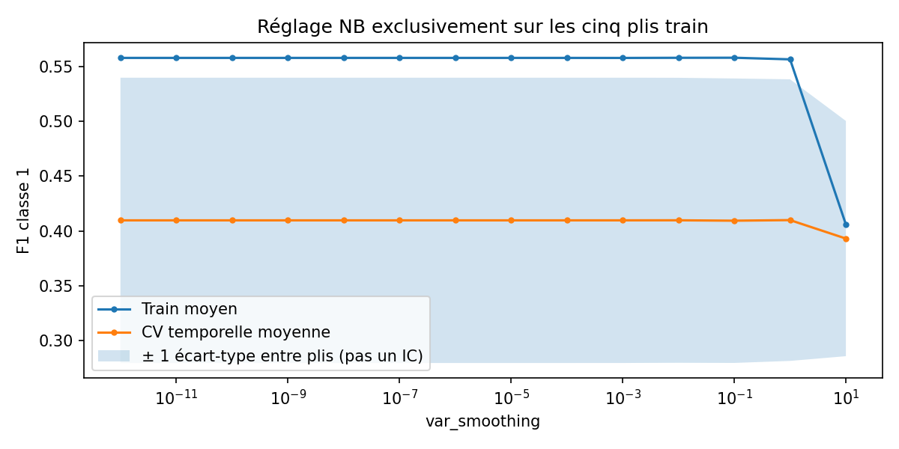
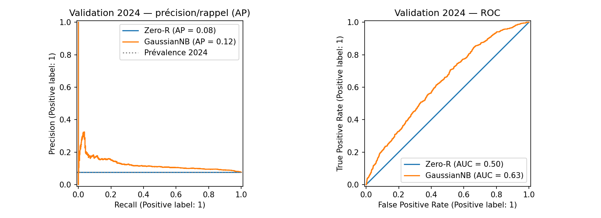
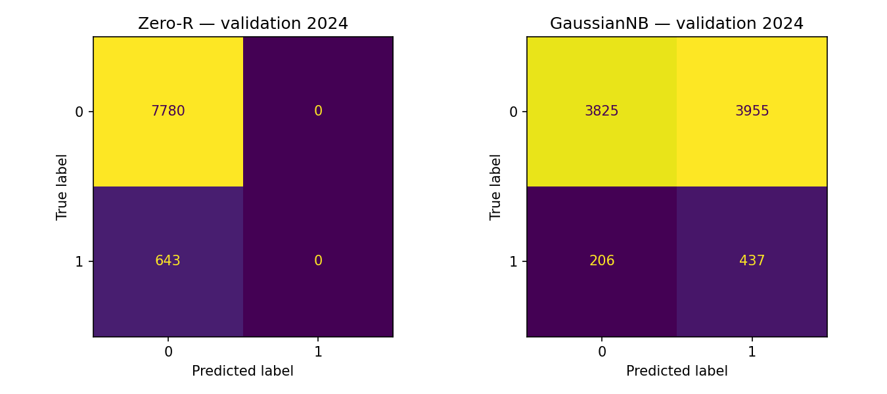

# Annexe scientifique personnelle — Zero-R et GaussianNB

## Question et méthode

L'optimum historique de GaussianNB (`var_smoothing=0.01`) se trouvait à la borne
supérieure de sept réglages. La recherche étendue vérifie si cette borne limitait
la sélection. Même liste de 24 variables, imputation médiane et StandardScaler
ajustés dans chaque pli, même critère F1 positif et mêmes validations 2019–2023.
Les sept configurations historiques sont incluses et leurs scores CV sont reproduits.

Le modèle gaussien suppose une indépendance conditionnelle imparfaite ici : températures,
indices d'incendie et humidité sont liés. La standardisation rend la régularisation des
variances moins dépendante de l'échelle ; elle ne rend pas les variables indépendantes.
L'échantillonnage de négatifs et la météo du jour limitent l'usage à la classification
rétrospective, sans interprétation comme risque territorial ou alerte anticipée.

## Résultats effectivement exécutés

|Expérience|Réglage|F1 CV moyen|F1 2024|Rappel 2024|ROC-AUC 2024|
|---|---:|---:|---:|---:|---:|
|Zero-R|Majorité train|0|0|0|0.500000|
|GaussianNB historique|0.01|Environ 0.410|0.1767|0.7294|0.6299|
|GaussianNB grille étendue|1.0|0.410006|0.173585|0.679627|0.631448|

Les valeurs historiques sont conservées dans les résultats existants ; elles ne sont
pas remplacées par les nouveaux chiffres. La moyenne CV change très peu : aucun gain
scientifiquement significatif n'est établi. L'écart-type inter-plis du nouveau F1 vaut
0.128328 ; il ne constitue pas un intervalle de confiance sur une performance future.

Sur les 8 423 observations de 2024, il existe 643 positifs :
- Zero-R : TN 7 780, FP 0, FN 643, TP 0 ; accuracy 0.923661, mais rappel nul.
- Nouveau GaussianNB : TN 3 825, FP 3 955, FN 206, TP 437 ; précision 0.099499,
  rappel 0.679627, accuracy 0.505995, F1 0.173585.
- AP (average precision) = 0.122362, contre une prévalence 2024 de 0.076339.
  AP résume la courbe précision-rappel ; ce n'est pas une aire trapézoïdale PR-AUC.
- Brier = 0.397791 ; les probabilités NB ne sont pas certifiées calibrées.

La diminution de F1 sur 2024 par rapport au réglage historique est conservée. L'extension
de grille améliore la vérifiabilité, pas nécessairement la prédiction. On ne choisit
pas un seuil ou un autre réglage après lecture de 2024 pour afficher un meilleur score.
L'examen répété de 2024 rend cette validation exploratoire ; 2025 demeure entièrement
réservé à une évaluation finale après gel collectif.

## Figures et interprétation

La courbe montre la faible séparation des réglages utiles au regard de la variation
entre années. L'optimum 1.0 est intérieur à la grille étendue.

ROC-AUC et AP complètent le F1 sans masquer les faux positifs. La prévalence est propre
à la validation échantillonnée ; elle n'est pas une estimation du risque en Algérie.

Le compromis est explicite : NB récupère 437 détections, au prix de 3 955 fausses alertes
par rapport aux étiquettes. Zero-R est insuffisant pour repérer les positifs malgré son accuracy.

## Reproduction et limites

Deux exécutions indépendantes produisent exactement les mêmes métriques, prédictions,
scores CV (hors durées), calibration et erreurs mensuelles. Les modèles rechargés
reproduisent leurs probabilités. Les tests modifient artificiellement les valeurs
2025 pour prouver leur absence d'influence ; ces données synthétiques de test logiciel
ne sont jamais utilisées pour les résultats scientifiques.

Les graphiques, tests d'artefacts et lignes de provenance permettent de contrôler chaque
chiffre. Aucune expérience des collaborateurs ni aucun fichier antérieur n'est modifié.
Les codes tests synthétiques n'évaluent pas le vrai test 2025. Le protocole proposé doit
encore être confirmé ; les mêmes cellules reviennent dans plusieurs années, donc la
validation temporelle ne démontre pas la généralisation à des territoires nouveaux.
